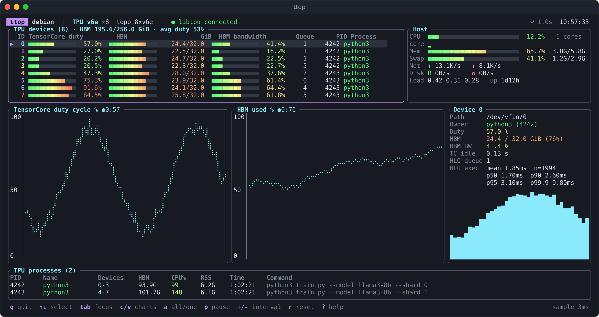

<div align="center">

# ttop

**Google Cloud TPU 向けのインタラクティブなターミナルモニター**


[English](../README.md) | [简体中文](README.zh-CN.md) | **日本語**

[画面構成](#画面構成) · [インストール](#インストール) · [使い方](#使い方) · [データソース](#データソース) · [開発](#開発)

</div>

<p align="center">
  
</p>

ttop は Google Cloud TPU 向けのターミナル監視ツールで、`jtop`（Jetson）や `btop` を参考にしたインターフェースを備えています。Rust と ratatui で実装されており、単一の静的バイナリとして配布され、実行時に Python を必要としません。

## 画面構成

| 領域 | 内容 |
|---|---|
| ヘッダー | ホスト名、チップの種類と数、トポロジー、libtpu の接続状態とバージョン、更新間隔、現在時刻 |
| TPU devices | 各論理デバイスの TensorCore デューティサイクル、HBM 使用量、HBM 帯域幅の使用率、HLO キューの長さ、使用中のプロセス |
| Host | CPU 全体の使用率、コアごとのヒートストリップ（180 コアを超える TPU ホスト向け）、メモリ、スワップ、ネットワーク、ディスク、ロードアベレージ、稼働時間 |
| 履歴グラフ | 切り替え可能な 2 つの履歴グラフ（duty / HBM / 帯域幅）。全デバイスまたは選択中のデバイスのみを表示でき、デバイス数が 8 を超える場合は平均値の線を描画します |
| デバイス詳細 | 選択中のデバイスのパス、所属プロセス、各指標、TensorCore のアイドル時間、HLO 実行時間（mean / p50 / p90 / p95 / p99.9） |
| TPU processes | TPU デバイスファイルを保持しているプロセスと、各プロセスが使用するデバイスおよび HBM の合計 |

## インストール

### ワンライナーでのインストール

```bash
curl -fsSL https://raw.githubusercontent.com/HiroGitea/ttop/main/install.sh | sh
```

インストールスクリプトは、現在のアーキテクチャ（x86_64 または aarch64）に対応する静的バイナリを GitHub Releases からダウンロードし、SHA-256 チェックサムを検証したうえで `~/.local/bin` にインストールします。ユーザーが書き込めるディレクトリにインストールすることで、ttop は `sudo` なしで自動アップデートできます。このディレクトリが `PATH` に含まれていない場合は、シェルの設定ファイルに追加する行が表示されます。次の環境変数を指定できます。

| 変数 | 説明 | デフォルト |
|---|---|---|
| `TTOP_VERSION` | インストールするリリースのタグ（例：`v0.1.0`） | 最新リリース |
| `TTOP_INSTALL_DIR` | インストール先ディレクトリ（書き込めない場合は `sudo` を使用） | `~/.local/bin` |

たとえば、特定のバージョンをシステム全体にインストールするには、次のように実行します。

```bash
curl -fsSL https://raw.githubusercontent.com/HiroGitea/ttop/main/install.sh | TTOP_VERSION=v0.1.0 TTOP_INSTALL_DIR=/usr/local/bin sh
```

アンインストールするには、バイナリを削除してください（例：`rm ~/.local/bin/ttop`）。

### 自動アップデート

リリース版は、インタラクティブ UI を起動するたびにバックグラウンドで GitHub Releases を確認します。新しいバージョンがある場合は、ダウンロードとチェックサムの検証を行ったうえで自身のバイナリを置き換え、フッターに `✓ updated to vX.Y.Z · restart to apply` と表示します。すでに最新版の場合は何も表示しません。

- バイナリのあるディレクトリに書き込めない場合（例：`/usr/local/bin`）は、新しいバージョンがあることだけを表示します。`sudo ttop --update` を実行するとアップデートできます。
- `ttop --update` を実行すると、いつでも最新版に手動でアップデートできます。自動アップデートの対象外であるソースからのビルドにも使用できます。
- 非インタラクティブモード（`--once`、`--json`、`--list-metrics`）ではアップデートを確認しません。
- 環境変数 `TTOP_DISABLE_AUTOUPDATER=1` を設定すると、自動アップデートを無効にできます。

### 手動ダウンロード

ビルド済みバイナリは [Releases](https://github.com/HiroGitea/ttop/releases) ページで公開しています。

| ファイル | プラットフォーム |
|---|---|
| `ttop-linux-x86_64` | x86_64 Linux、静的リンク（musl） |
| `ttop-linux-aarch64` | aarch64 Linux、静的リンク（musl） |

ダウンロード後、`chmod +x` で実行権限を付与してください。チェックサムは `SHA256SUMS` に記載されています。

### ソースからのビルド

```bash
git clone https://github.com/HiroGitea/ttop.git
cd ttop
cargo build --release
./target/release/ttop
```

`protoc` は不要です。libtpu 指標サービスの protobuf メッセージは、手書きの prost 構造体（`src/proto.rs`）として実装されています。

### 静的バイナリのクロスコンパイル

別のマシンで x86_64 向けの静的バイナリをビルドし、TPU VM にコピーして実行する場合は、次のコマンドを使用します。

```bash
rustup target add x86_64-unknown-linux-musl
RUSTFLAGS="-C linker=rust-lld -C target-feature=+crt-static" \
  cargo build --release --target x86_64-unknown-linux-musl
```

## 使い方

### インタラクティブモード

```bash
ttop                                      # インタラクティブ UI を起動
ttop --demo                               # シミュレーションデータで UI を確認（TPU 不要）
ttop --demo --chip 7x --demo-devices 16   # TPU7x の論理デバイス 16 個をシミュレート
ttop -i 0.5                               # 更新間隔を 0.5 秒に設定
ttop -p 8431,8432                         # 複数の libtpu 指標ポートを指定
```

### 非インタラクティブ出力

```bash
ttop --once                               # テキストのスナップショットを 1 回出力して終了
ttop --json -n 0 -i 5                     # 5 秒ごとに JSON を 1 行出力（スクリプトでの収集向け）
ttop --list-metrics                       # 実行中の libtpu が対応する指標名をすべて表示
ttop --update                             # 最新版にアップデート
```

すべてのオプションは `ttop --help` で確認できます。

### キー操作

| キー | 動作 |
|---|---|
| <kbd>q</kbd> / <kbd>Esc</kbd> / <kbd>Ctrl</kbd>+<kbd>C</kbd> | 終了 |
| <kbd>↑</kbd> <kbd>↓</kbd> / <kbd>k</kbd> <kbd>j</kbd> | デバイスまたはプロセスを選択 |
| <kbd>Tab</kbd> | デバイス一覧とプロセス一覧の間でフォーカスを切り替え |
| <kbd>c</kbd> / <kbd>v</kbd> | 左 / 右のグラフの指標を切り替え（duty → HBM → 帯域幅） |
| <kbd>a</kbd> | グラフの表示対象を全デバイスと選択中のデバイスで切り替え |
| <kbd>p</kbd> / <kbd>Space</kbd> | サンプリングの一時停止 / 再開 |
| <kbd>+</kbd> / <kbd>-</kbd> | 更新間隔を長く / 短く（0.1 – 10 秒） |
| <kbd>r</kbd> | グラフの履歴を消去 |
| <kbd>?</kbd> / <kbd>h</kbd> / <kbd>F1</kbd> | ヘルプを表示 |

## データソース

ttop は、Google 公式ツール `tpu-info`（cloud-accelerator-diagnostics）と同じデータソースを使用しています。

| データ | 取得元 |
|---|---|
| チップの検出 | `/sys/bus/pci/devices` から Google のベンダー ID `0x1ae0` を持つデバイスを抽出し、PCI デバイス ID により v2 / v3 / v4 / v5e / v5p / v6e / TPU7x を識別 |
| ランタイム指標 | libtpu に組み込まれた gRPC サービス `tpu.monitoring.runtime.RuntimeMetricService`（デフォルトは `localhost:8431`）。マルチスライスのジョブでは、`TPU_RUNTIME_METRICS_PORTS=8431,8432,...` または `-p` で複数のポートを指定 |
| プロセス | `/proc/*/fd` を走査し、`/dev/vfio/N` または `/dev/accelN` を開いているプロセスを検出 |

> [!NOTE]
> ランタイム指標サービスは、JAX や PyTorch/XLA などのフレームワークが TPU を使用している間のみ利用できます。ジョブが実行されていない場合、ヘッダーには「libtpu idle」と表示されますが、チップ、プロセス、ホストの情報は引き続き表示されます。

> [!TIP]
> root 以外のユーザーには自身のプロセスのみが表示されます。他のユーザーのプロセスを表示するには、`sudo "$(command -v ttop)"` のように root 権限で ttop を実行してください（`sudo` はデフォルトで `~/.local/bin` を検索しません）。

## 開発

### コード構成

```
src/main.rs     コマンドライン引数、イベントループ、--once / --json 出力
src/device.rs   PCI sysfs によるチップ検出、/proc による使用中プロセスの検出
src/proto.rs    libtpu 指標サービスの protobuf メッセージ（手書きの prost）
src/grpc.rs     tonic クライアント（GetRuntimeMetric / ListSupportedMetrics）
src/sampler.rs  サンプリング：実機バックエンド（PCI + gRPC + procfs）と --demo のモックバックエンド
src/host.rs     ホストの CPU / メモリ / ネットワーク / ディスク / プロセス統計
src/app.rs      UI の状態と履歴データ
src/ui.rs       ratatui による描画
src/update.rs   GitHub Releases からの自動アップデート
```

### テスト

`cargo test` で単体テストを実行できます。protobuf のエンコードとデコード、2 種類のデバイス ID 形式、チップ単位の duty cycle を各デバイスに複製するロジック、および tpu-info の `_get_percentile` と同一のパーセンタイル計算をテストしています。

### リリース

`v*` 形式のタグをプッシュすると、GitHub Actions（`.github/workflows/release.yml`）がテストを実行し、x86_64 と arm64 のランナーで静的バイナリをビルドして、`SHA256SUMS` とともに GitHub Release として公開します。タグは `Cargo.toml` の `version` と一致している必要があります。このワークフローはビルド時に `TTOP_RELEASE_BUILD=1` を設定して自動アップデートを有効にします。ローカルでのビルドでは無効のままです。

```bash
git tag v0.1.0
git push origin v0.1.0
```

## ライセンス

本プロジェクトは Apache License 2.0 の下で公開されています。
